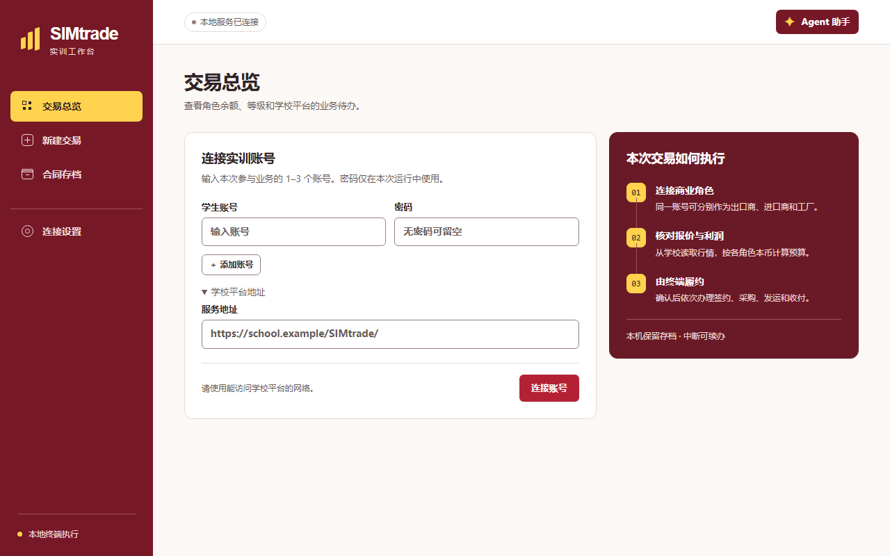

# SIMtrade 实训工作台

在一台 Windows 电脑上连接 1–10 个 SIMtrade 学生账号，查看出口商、进口商和工厂的余额与待办，按三方预算试算报价，并接续本机保存的合同。可以用浏览器界面、终端菜单或内置 Agent 操作。

## 下载和启动

1. [下载 Windows x64 压缩包](https://github.com/smy19801388613-afk/simtrade-workbench/releases/latest/download/SIMtrade-workbench-Agent-Windows-x64.zip)，完整解压到可写目录，双击 `SIMtrade工作台.exe`。浏览器会自动打开，使用期间请保持终端窗口开启。
2. 连上校园网或学校 VPN，输入本次使用的学生账号和密码，点击「连接账号」。工作台已预填 `http://80.80.80.23/simtrade/`。使用其他学校的平台时，可在「学校平台地址」中修改。
3. 在「新建交易」选择商品、箱数、贸易术语和结算方式，核对各角色分工和预计利润后再确认办理。FOB、CFR、CIF 可分别搭配 T/T、D/P、D/A、L/C，也可以逐笔指定。

在自己的电脑上可以勾选记住账号和密码。连接成功后，下次打开同一数据目录，工作台会按原顺序填回该学校的账号。密码由当前 Windows 用户加密保存，浏览器和终端共用同一组记忆。

每批可安排 1–100 笔。选择「均衡轮换交易对象」，工作台会参考已结案合同和本批安排，优先轮换出口商的买方和供货工厂，并结合三种角色各自的参与次数与等级安排分工。默认自动选品也会参考三种角色各自做过的商品。

商品轮换默认选「已结案商品」，包含床单、壁钟、直杆伞、手提包、男士皮鞋、双门冰箱、便携式脑电图仪。从冰箱起做两笔，就会依次选中冰箱和脑电图仪。工作台按实时行情试算，正常到货时会为这两种商品办理进口报检。

直接点「生成报价」，工作台就会按每笔进口商所在国选港。默认港口无法取得运价，或按当前现金保留比例无法做成盈利订单时，工作台会尝试同国其他港口。实际采用的港口显示在订单预览中。合同要求固定港口时，可展开选港栏手动指定。

## Agent 助手

在界面右上角打开「Agent 助手」。可以输入“试算一笔床单，三箱，FOB＋D/P”，再说“改成 CIF＋L/C，其余不变”。也可以让它运行终端自检，或按合同号核对实际收支。正式开单和续办都会显示确认单。

使用 DeepSeek 时，在「连接设置」保留默认的「DeepSeek 官方」，填入 API Key，点击「测试并启用」。工作台会用预填的 `deepseek-flash` 发送一条测试消息，收到回复后即可在 Agent 助手中提问。其他兼容服务可以使用自定义地址和模型名。

合同和回执保存在本机的 `工作台数据` 目录。有关数据范围、旧版存档和模型设置，请参阅[使用说明](使用说明.md)。

## 从源码运行

需要 Python 3.10 或更高版本。程序使用 Python 标准库。在项目目录运行 `python desktop.py` 打开浏览器界面，或运行 `python workbench.py` 进入终端菜单。离线自检命令为 `python workbench.py --self-check`。
